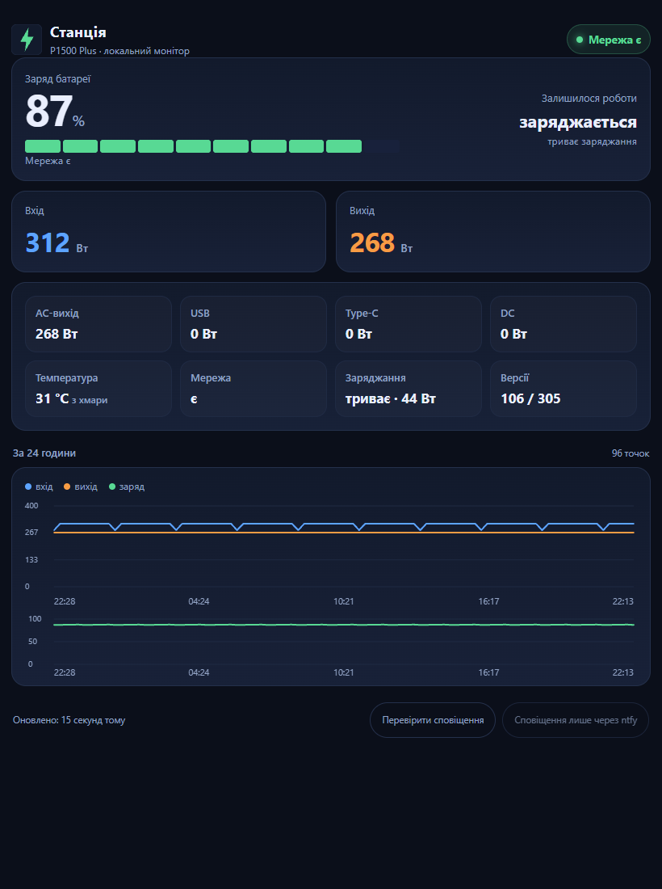

# Монітор зарядної станції P1000/P1500 Plus

Локальний моніторинг портативної зарядної станції, яка працює з Wonderfree
(Quectel / Acceleronix). Телеметрія йде по домашній мережі, сповіщення — через
локальний `ntfy`, панель відкривається з телефона або ПК.

Керування і панель — локальні, хмара потрібна один раз, щоб отримати ключ
станції.

> ⚠️ **Але повної автономії при падінні провайдера немає.** Станція віддає
> телеметрію по LAN тільки поки має живий зв'язок з хмарою Quectel. Без
> інтернету вона все одно приймає з'єднання і підтверджує команди, але даних не
> надсилає — панель показує «Станція не надсилає дані». Це поведінка прошивки,
> а не цього коду; підтверджено на P2001E Plus і P1500E Plus. Деталі —
> [issue #6](https://github.com/bordeux/ha-oukitel-powerstation/issues/6)
> в апстрімі.

<p align="center">
  
</p>

<p align="center"><sub>Приклад вигляду панелі. Дані залежать від станції.</sub></p>

## Навіщо це

У Wonderfree є неприємна звичка: станція зникає з застосунку, коли падає
інтернет або Wi-Fi. Саме тоді й хочеться знати, чи вона ще на мережі, чи вже
на батареї, скільки залишилось і чи йде заряджання.

Цей проєкт читає станцію напряму по LAN і показує:

- заряд батареї, вхід/вихід, AC/USB/Type-C/DC, температуру;
- чи мережа реально покриває навантаження, а не просто «вхід > 0»;
- коли станція перейшла на батарею і коли повернулась;
- коли світло є, але станція не заряджається;
- скільки приблизно залишилось роботи з урахуванням фактичного розряду;
- історію за 24 години;
- сповіщення на телефон через `ntfy` і на ПК через трей.

Керування виходами AC/DC тут свідомо немає. Тільки моніторинг.

## Як це працює

```
Станція  ── TCP 6607 ──►  Android/Termux  ── HTTP/SSE ──►  PWA-панель
                              │
                              ├── ntfy ──► телефон
                              ├── SQLite (історія)
                              └── SSE ──► трей на ПК
```

- **Станція** віддає TTLV-телеметрію по TCP 6607, AES-128-CBC.
- **Сервер** — старий Android-телефон у Termux. Він тримає з'єднання зі
  станцією, рахує статуси, пише історію і віддає панель.
- **ntfy** — локальний сервер на тому ж телефоні. Android-застосунок `ntfy`
  отримує сповіщення по Wi-Fi, без інтернету.
- **ПК** — маленький трей-клієнт на Windows. Читає SSE з сервера.

## Що потрібно

- Станція **P1000 Plus / P1500 Plus** або інша модель на Quectel/Acceleronix з
  застосунком Wonderfree. Перевірено на P1500 Plus, `productKey = p11uve`.
- Android-телефон для сервера: Termux, Android 11+, 2 ГБ RAM, 2.4 ГГц Wi-Fi.
  Старий телефон підходить.
- Роутер, до якого підключені і станція, і сервер. Бажано зарезервувати IP.
- Акаунт Wonderfree — один раз, щоб отримати `authKey`.
- Windows 10/11 для трея — за бажанням.

## Встановлення

### 1. Підготуй Termux

Termux ставиться з F-Droid, не з Google Play: версія в Play Store застаріла.

```bash
pkg update -y
pkg install -y git python python-cryptography nano
```

Склонуй репозиторій:

```bash
git clone https://github.com/Ner-Kun/powerstation-monitor.git ~/powerstation-monitor
cd ~/powerstation-monitor
```

### 2. Знайди станцію в мережі

```bash
python tools/discover.py
```

Скрипт розсилає UDP-запит на 6606 і покаже щось таке:

```
[station] ip=192.168.1.100 pk=p11uve dk=aabbccddeeff port=6607
```

Запиши `ip`, `pk` і `dk`. `ip` піде в конфіг, `pk`/`dk` — у наступний крок.

### 3. Отримай `authKey`

Це одноразовий вхід у Wonderfree-акаунт. Ключ зберігається локально, у
`.secrets/authkey.json`, і нікуди не відправляється.

```bash
export QUECTEL_EMAIL='твій@email'
export QUECTEL_PASSWORD='твій пароль'
python tools/get_authkey.py
```

Якщо в акаунті одна станція — скрипт вибере її сам. Якщо кілька — передай
`pk` і `dk`:

```bash
python tools/get_authkey.py --pk p11uve --dk aabbccddeeff
```

Ключ може змінитися після переприв'язки станції. Тоді просто запусти скрипт
ще раз.

### 4. Температура з хмари — за бажанням

У станції є свій датчик температури (властивість `14` у моделі даних), але
прошивка не віддає його по LAN — ні в звітах, ні у відповідь на READ. Це
перевірено на тому самому модулі FCM100D: фокусовані запити тега `14` і
10-хвилинне спостереження не дали жодного значення. Так само з напругою виходу
(`28`). Обидва беруться тільки з хмари Wonderfree, тож без інтернету температури
не буде. Якщо хочеш бачити її в панелі:

```bash
export QUECTEL_EMAIL='твій@email'
export QUECTEL_PASSWORD='твій пароль'
python tools/save_cloud_creds.py
```

Скрипт збереже `.secrets/cloud.json`. Пароль лежить тільки на сервері,
`chmod 600`, у логи не потрапляє.

Якщо температура не потрібна — не запускай цей крок і постав
`"cloud_enabled": false` у конфізі.

### 5. Налаштуй конфіг

```bash
cp config.example.json config.json
nano config.json
```

Мінімум, що треба змінити:

```json
{
  "station_host": "192.168.1.100",
  "capacity_wh": 1536
}
```

- `station_host` — IP з кроку 2.
- `capacity_wh` — `1536` для P1500 Plus, `1024` для P1000 Plus.
- `ntfy_topic` за замовчуванням `station` — можна лишити.
- `cloud_enabled` — `false`, якщо температура не потрібна.

Решта порогів має розумні значення. Їх можна підкрутити пізніше.

### 6. Збери `ntfy` під Android

Готовий linux-arm64 бінарник на Android падає з `Bad system call`. Тому
`ntfy` треба зібрати на самому телефоні з CGO:

```bash
bash scripts/build_ntfy.sh
```

Скрипт поставить Go і sqlite, склонує ntfy v2.38.1 і збереже
`bin/ntfy-cgo`. Перший збір займає 10–15 хвилин і близько 500 МБ диска.

Якщо не хочеш збирати, візьми готовий бінарник із Releases (Android arm64):

```bash
mkdir -p bin
curl -L -o bin/ntfy-cgo https://github.com/Ner-Kun/powerstation-monitor/releases/download/v0.1.0/ntfy-cgo
chmod +x bin/ntfy-cgo
```

### 7. Автозапуск у Termux

Постав із F-Droid **Termux:API** і **Termux:Boot**.

```bash
mkdir -p ~/.termux/boot
cp deploy/start-powerstation.sh ~/.termux/boot/
chmod +x ~/.termux/boot/start-powerstation.sh deploy/keepalive.sh
termux-wake-lock
```

У налаштуваннях Android:

- Termux → Батарея → **Без обмежень**;
- Wi-Fi → не вимикати в сплячому режимі;
- на MIUI/HyperOS — дозволити автозапуск Termux.

`Termux:Boot` запускає `keepalive.sh`, а той тримає `ntfy` і монитор. Якщо
процес впаде — підніме за 30 секунд.

### 8. Запусти

```bash
./deploy/keepalive.sh
```

Перевірка:

```bash
curl http://127.0.0.1:8765/api/health
curl http://127.0.0.1:8765/api/state
```

Панель: `http://IP-СЕРВЕРА:8765` з телефона або ПК.

Тестове сповіщення:

```bash
curl -X POST http://IP-СЕРВЕРА:8765/api/test-alert
```

### 9. `ntfy` на основному телефоні

Постав **ntfy** з Google Play або F-Droid. У застосунку:

1. Додай сервер `http://IP-СЕРВЕРА:2586`.
2. Підпишись на тему `station`.
3. Дозволь сповіщення.
4. Увімкни **Instant delivery / Use WebSockets**.
5. Постав батарею **Без обмежень**, на MIUI — автозапуск.

Телефон має бути в домашній Wi-Fi. Через мобільний інтернет локальний
сервер недоступний.

### 10. Трей на ПК — за бажанням

```powershell
cd pc
python -m venv .venv
.venv\Scripts\pip install -r requirements.txt
copy config.example.json config.json
notepad config.json
.venv\Scripts\python tray.py
```

У `pc/config.json` вкажи `base_url` сервера, наприклад:

```json
{ "base_url": "http://192.168.1.50:8765" }
```

Щоб трей стартував сам: `Win+R` → `shell:startup` → поклади туди ярлик на
`start-tray.cmd`.

### 11. Закріпи IP на роутері

Зроби DHCP-резервацію для двох пристроїв:

- **сервер** (Android-телефон) — його IP використовують `ntfy`, панель і трей;
- **станція** — її IP прописаний у `config.json`.

MAC-адреси візьми в списку клієнтів роутера. Без резервації після ребута
адреса може змінитися, і все відвалиться.

## Сповіщення

| Подія | Коли |
|---|---|
| **Станція на батареї** | входу не вистачає на вихід: або 0 Вт, або просадка/перенапруга |
| **Станція знову на мережі** | вхід почав покривати навантаження |
| **Світло є, але станція не заряджається** | вхід покриває вихід, заряджання 0 Вт, заряд нижче 95% довше 10 хв |
| **Заряджання почалося** | станція почала заряджатися |
| **Мало заряду** | 20%, 10%, 5% |
| **Станція не відповідає** | немає зв'язку зовсім — перевір Wi-Fi і живлення |
| **Станція не надсилає дані** | зв'язок і логін є, але телеметрії немає — найчастіше станція без зв'язку з хмарою Quectel |

Пороги живуть у `config.json`: `power_*`, `not_charging_*`, `low_battery_pct`,
`telemetry_timeout_seconds`.

## Конфіг

| Ключ | За замовчуванням | Що робить |
|---|---:|---|
| `station_host` | — | IP станції |
| `station_port` | `6607` | TCP-порт станції |
| `authkey_file` | `.secrets/authkey.json` | ключ станції |
| `ntfy_url` | `http://127.0.0.1:2586` | локальний ntfy |
| `ntfy_topic` | `station` | тема сповіщень |
| `http_host` | `0.0.0.0` | панель слухає LAN |
| `http_port` | `8765` | порт панелі |
| `capacity_wh` | `1536` | ємність батареї |
| `efficiency` | `0.9` | поправка на інвертор |
| `power_min_input_w` | `5` | нижче цього вхід вважається відсутнім |
| `power_min_output_w` | `5` | нижче цього баланс не перевіряємо |
| `power_margin_w` | `20` | допустимий дефіцит входу, Вт |
| `power_margin_pct` | `0.1` | допустимий дефіцит входу, частка |
| `power_initial_seconds` | `5` | перше визначення стану |
| `power_battery_seconds` | `30` | скільки дефіцит тримається до «на батареї» |
| `power_grid_seconds` | `10` | скільки входу покривати вихід до «знову на мережі» |
| `not_charging_battery_pct` | `95` | нижче цього чекаємо заряджання |
| `not_charging_seconds` | `600` | скільки чекати до тривоги |
| `low_battery_pct` | `20` | перший поріг «мало заряду» |
| `telemetry_timeout_seconds` | `60` | коли показувати «немає даних» |
| `station_stale_seconds` | `90` | коли перепідключатися до станції |
| `cloud_enabled` | `true` | тягнути температуру з хмари |
| `cloud_poll_seconds` | `120` | як часто ходити в хмару |
| `cloud_stale_seconds` | `900` | після цього температура з хмари вважається застарілою |
| `history_db` | `data/history.db` | SQLite-історія |
| `history_interval_seconds` | `10` | крок історії |
| `history_retention_days` | `30` | скільки зберігати |

## API

Локально, без авторизації. Не виставляй у WAN.

- `GET /api/state` — поточний стан.
- `GET /api/history?hours=24` — історія.
- `GET /api/health` — перевірка.
- `GET /events` — SSE-потік.
- `POST /api/test-alert` — тестове сповіщення.

## Якщо щось не працює

**Станція не знаходиться.** Перевір, що вона в тій самій Wi-Fi (2.4 ГГц), що й
телефон. У роутері має бути вимкнений AP isolation. Спробуй
`python tools/discover.py` ще раз.

**`authKey` не підходить.** Перезапусти `tools/get_authkey.py`. Ключ
змінюється після переприв'язки станції. Якщо акаунт не EU — можливо, потрібен
інший регіон; у скрипті зараз EU-гілки.

**Температура не оновлюється.** Перевір `.secrets/cloud.json`,
`cloud_enabled` і чи станція онлайн у хмарі Wonderfree. Якщо хмара недоступна,
лишається останнє відоме значення.

**Немає сповіщень на телефоні.** Телефон має бути в домашній Wi-Fi. Перевір
сервер `http://IP:2586`, тему `station`, Instant delivery і обмеження
батареї. На MIUI — автозапуск.

**Станція періодично зникає.** У станції слабкий Wi-Fi-модуль. Монитор
перепідключається сам. Якщо відкритий Wonderfree — закрий його: станція може
тримати одну сесію телеметрії. Дивись `monitor.log`.

**Termux вбиває процес.** Батарея → Без обмежень, `termux-wake-lock`,
Termux:Boot, `keepalive.sh`. На MIUI ще автозапуск.

**Змінився IP.** Зроби DHCP-резервацію. Після зміни IP онови `config.json`,
`pc/config.json` і адресу сервера в ntfy.

**Станція приймає з'єднання, але не надсилає телеметрію.** Найчастіша причина —
станція не може достукатися до хмари Quectel. Саме тоді вона проходить логін,
підтверджує команди і мовчить. Перевір, чи станція взагалі має інтернет: Wi-Fi,
блокування в роутері, батьківський контроль. Друга причина — завис модуль:
вимкни станцію і ввімкни знову. Третя, рідкісна — сесію тримає Wonderfree, тоді
закрий застосунок на телефоні. `python tools/discover.py` при цьому відповідає,
тобто модуль живий, але звіти не йдуть.

**Станція не віддає телеметрію без інтернету.** Це головне обмеження проєкту:
LAN-звіти живуть, поки станція має живий зв'язок з хмарою. Панель при цьому
показує «Станція не надсилає дані», а не «немає зв'язку». Для повної автономії
потрібен окремий датчик світла — див. «Обмеження».

## Безпека й приватність

- `.secrets/authkey.json` — ключ станції. Не коміть, не пересилай.
- `.secrets/cloud.json` — email/пароль Wonderfree. Лежить тільки на сервері,
  `chmod 600`.
- Панель і ntfy не мають авторизації. Це домашня мережа, не інтернет.
- Не роби port-forward на 8765/2586. Якщо потрібен доступ ззовні — VPN або
  reverse proxy з авторизацією.
- Хмара Wonderfree використовується тільки для `authKey` і, за бажанням, для
  температури. Решта — локально.

## Обмеження

- Перевірено на P1500 Plus (`p11uve`). Інші моделі можуть мати інші теги.
- Станція не віддає напругу мережі — тільки потужність. Тому 180/264 В
  видно як «вхід не покриває вихід», а не як вольти.
- `remain_time` станції не завжди правдивий; залишок рахуємо самі.
- Температура — з хмари. Без інтернету її немає; замість старої цифри панель
  покаже прочерк після `cloud_stale_seconds`.
- Керування виходами немає.
- HTTP-панель не є повноцінним PWA: service worker на HTTP не працює.
  Сповіщення — через ntfy.
- **LAN-телеметрія залежить від інтернету станції.** Поки станція не має живого
  зв'язку з хмарою Quectel, вона мовчить по LAN. Це прошивка, обійти з боку
  клієнта не виходить. Хто хоче знати про зникнення світла саме тоді, коли
  інтернет теж упав, — потрібен окремий локальний датчик: Wi-Fi реле на лінії,
  ESP з оптроном або розумна розетка з локальним API. Монитор до такого можна
  прикрутити окремим джерелом.
- Wi-Fi-модуль станції може відвалюватися; монитор це бачить, але не лікує.

## Розробка

```bash
python -m py_compile station.py monitor.py cloud.py pc/tray.py
python tools/test_alerts.py
python tools/station_test.py 192.168.1.100
```

Код і логи — англійською. Інтерфейс, сповіщення і трей — українською.

Протокол реверс-інжинирився з застосунку Wonderfree. За основу брали
[bordeux/ha-oukitel-powerstation](https://github.com/bordeux/ha-oukitel-powerstation).
`ntfy` — [binwiederhier/ntfy](https://github.com/binwiederhier/ntfy).
Трей — `pystray` + `winotify`.

## Ліцензія

MIT. Див. [LICENSE](LICENSE).

## Дисклеймер

Це неофіційний проєкт. Він не пов'язаний з Oukitel, EENOUR, Quectel,
Acceleronix або Wonderfree. Протокол реверс-інжинирився; прошивка станції може
змінитися і зламати сумісність. Використовуй на свій ризик. Не для систем, від
яких залежить життя чи безпека.
